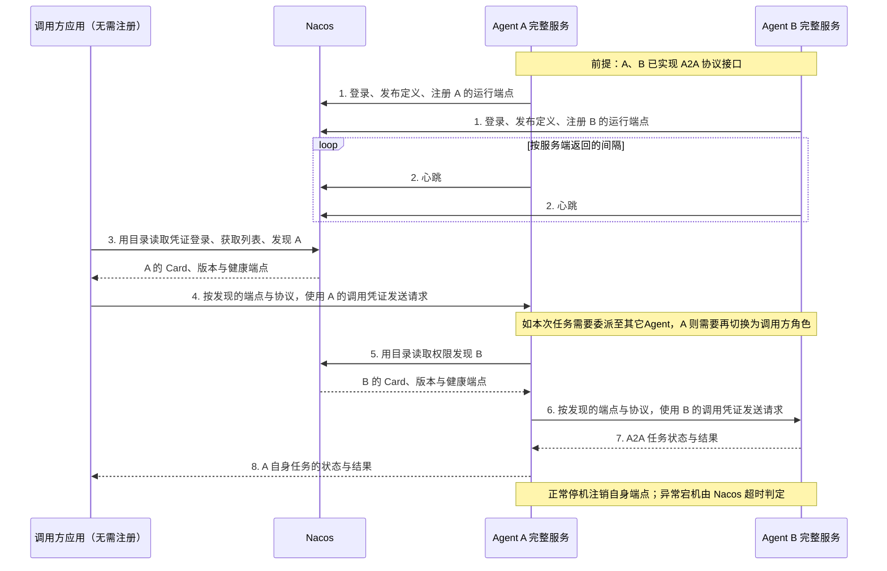

# A2A 与 Nacos：异构 Agent 接入指南

核对日期：2026-11-12。本文使用 **A2A 协议 1.0**、官方 Python **a2a-sdk 1.3.0**、
**Nacos Server 3.3.0**。SDK 包版本与协议版本是两个独立的版本号。

本文可用于 LangChain Deep Agents、OpenAI Agents SDK、Google ADK 或自研 harness。
调用者通过 AgentCard 和 A2A 请求获取任务结果；进程内适配与 sidecar 适配对调用者透明。
能否互通，取决于双方支持的协议版本、binding、鉴权和任务语义；仅提供同名 HTTP 路径不够。

## 1. 两个独立议题与开发者职责

接入分两阶段：**先让 harness 支持 A2A 协议，再让它接入 Nacos**。
A2A 定义调用协议、能力描述和任务交互；Nacos 管理目录、版本、运行端点和在线状态。
本文统一采用“通过 Nacos 发现服务，再按发现结果使用 A2A 协议调用”的流程。
两阶段分别实现、分别验收；Nacos 接入不要求改写 harness 的推理循环。
注册到 Nacos 不会自动把任意 HTTP 服务转换为 A2A 服务。

| 议题 | Agent 开发者负责 | 应用开发者负责 | 验收重点 |
| --- | --- | --- | --- |
| A：实现 A2A（第 2、3 节） | 包装已有 harness，提供 Card、鉴权、任务和结果接口 | 实现 A2A client，处理状态、会话和结果 | 协议、鉴权、任务状态与结果交付正确 |
| B：接入 Nacos（第 4～6 节） | 发布定义、注册端点、心跳、重连和注销 | 查询目录、选择健康端点，再交给 A2A client | 从 Nacos 发现健康端点并完成 A2A 调用 |

这里只区分两种**角色**，不按实现技术区分：

- **调用方应用**：传统 Web、桌面应用，或以 Codex、WorkBuddy、Claude Code 等为基础的应用。
  它需要 A2A client 和 Nacos 发现逻辑；具体产品可能需要额外工具或插件，不能假定原生具备这些能力。
  只消费服务的应用无需在 Nacos 注册自己。
- **对外提供服务的 Agent**：将 A2A 服务接口与已有 harness 组成一个完整服务，并向 Nacos 注册。
  当它需要委派给另一个 Agent 时，也承担调用方角色，使用相同的发现和调用流程。

### 1.1 注册、发现与调用流程

为了突出网络交互，下图将每个 Agent 的内部模块合并为一个参与者。
Agent A 在前半段提供服务，在后半段同时作为 Agent B 的调用方。



步骤 5～7 是可选的委派流程，需要 Agent A 显式实现调用工具、凭证管理和授权策略；
单独完成 A2A 服务适配和 Nacos 注册，不会自动赋予模型调用其它 Agent 的能力。
A、B 各自拥有独立的任务和 context；A 负责管理委派关系，Nacos 不合并会话或任务状态。

Nacos 负责返回目标服务的 Card、端点和健康状态，业务请求按发现结果发送到目标服务。
注册成功不代表调用方能够访问公布的端点；私网地址需要共享 LAN、VPN 或专用网络。
注册的 endpoint 必须可从调用方访问；跨不可信网络时应配置 HTTPS。

三类凭证独立：服务器 SSH、Nacos 用户/令牌、目标 A2A 服务凭证。
Nacos 的签名密钥和 server identity 留在 Nacos 服务器；AgentCard 和 endpoint metadata 不存密码。
注册服务通常需要自身定义/端点的写权限；纯调用应用只需要目录读取权限及目标服务的调用凭证。

### 1.2 Agent 名称与普通服务名

Agent 目录中的 `design-agent-lan` 是逻辑 Agent 名称。Nacos 普通服务列表中的
`agent-endpoints / rad-design-agent-lan-a2a` 是同一个 Agent 的 A2A 运行端点在 Naming 层的映射，
遵循 `rad-<encodedAgentId>-<protocol>` 规则，不是第二个 Agent。
应用使用 Agent 搜索和发现接口，不自行拼接底层服务名。

## 2. 议题 A：让任意 harness 对外提供 A2A

首先确定输入/输出类型、能否后台执行、会话存储位置和取消是否能停止全部工作。
把这些事实写入 Card，不能仅因为 SDK 提供路由就宣称支持对应能力。

| Harness | 接入点 |
| --- | --- |
| Deep Agents / LangGraph | 复用 `ainvoke` 或现有 runtime；保留 checkpointer/thread 身份 |
| OpenAI Agents SDK | 适配器调用现有 Runner；将已有 session、审批和工具权限映射到服务端身份 |
| Google ADK | 可使用其原生 A2A 导出；核对实际导出的版本/binding/Card，不假定所有版本默认 1.0 |
| 自研或其他模型/harness | 调用统一的 `invoke(text, trusted_context)`，转成 A2A Message/Task/Artifact |

模型厂商与 harness 无必然关系，使用 DeepSeek 模型本身不自动产生 A2A 服务。
可用 Python 适配进程包装另一种语言实现的内部 API；调用方不需要知道内部框架。

对于 Python，先安装并锁定官方 SDK：

```bash
uv add 'a2a-sdk[http-server]==1.3.0'
```

本仓库可作为完整的实现参考：

- `src/design_agent/surfaces/a2a/app.py`：AgentCard、SDK routes、可信身份、executor。
- `src/design_agent/surfaces/a2a/store.py`：按调用者隔离的持久化 TaskStore。
- `scripts/a2a_smoke.py`：官方 SDK 客户端；不依赖被调用方的 harness。

SDK 1.3.0 使用 protobuf 模型；不要将旧版 Pydantic `TextPart/MessageSendParams` 示例直接混用。
最小执行器的核心如下，`invoke_harness` 替换为自己的已有执行入口；还需接入鉴权、存储、routes
和 shutdown，如本仓库。此片段本身不是生产服务：

```python
from a2a.helpers.proto_helpers import new_task, new_text_message
from a2a.server.agent_execution import AgentExecutor
from a2a.server.tasks import TaskUpdater
from a2a.types import Part, TaskState
from a2a.utils.errors import TaskNotCancelableError


class HarnessExecutor(AgentExecutor):
    async def execute(self, context, queue):
        if context.current_task is None:
            await queue.enqueue_event(
                new_task(
                    context.task_id,
                    context.context_id,
                    TaskState.TASK_STATE_SUBMITTED,
                    history=[context.message],
                )
            )
        update = TaskUpdater(queue, context.task_id, context.context_id)
        await update.start_work()
        # identity comes from authentication, never from user metadata.
        caller = context.call_context.user.user_name
        # Scope context_id to caller before invoking the harness.
        text = await invoke_harness(context.get_user_input(), caller, context.context_id)
        await update.add_artifact([Part(text=text)], name="reply")
        await update.complete(
            new_text_message(text, context_id=context.context_id, task_id=context.task_id)
        )

    async def cancel(self, context, queue):
        raise TaskNotCancelableError()
```

应先 enqueue 初始 Task，再发状态/artifact。完成后台工作之前保持 working；
内部异常返回 failed，不将原始异常、模型 key 或堆栈当结果返回。
如 runtime 不能完整取消，在 request handler 入口直接返回 TaskNotCancelableError，
不能依赖 executor 抛错后 SDK 一定保留运行中的 producer；本仓库 handler 已显式处理。
如支持审批，持久化待审批状态，验证审批者权限后再映射 input-required/auth-required 和恢复操作。
注册中心权限不等于工具调用、发布或审批权限。

这一阶段负责验证 Card、鉴权、任务、会话隔离和结果交付的协议实现。
随后按第 4、5 节接入 Nacos，并按第 6 节完成发现与调用的端到端验收。

## 3. 议题 A：本仓库的 A2A 运行方式

A2A 是 `design-agent serve` 的可选入口，复用现有 `build_local_runtime`、sandbox、模型、工具和文件交付。
默认不启用；设置 `DESIGN_AGENT_A2A_URL` 后增加：

| 地址 / 操作 | 行为 |
| --- | --- |
| `GET /.well-known/agent-card.json` | 公开能力、协议和鉴权声明，不含凭证 |
| `POST /a2a` | 官方 SDK 的 A2A 1.0 JSON-RPC binding |
| `SendMessage` | 执行任务；`configuration.returnImmediately=true` 可立即获得任务 |
| `SendStreamingMessage` | SSE 状态和 artifact 更新 |
| `GetTask`, `ListTasks`, `SubscribeToTask` | 本调用者的任务查询与订阅 |
| `CancelTask` | 返回 task-not-cancelable，确保后台渲染不会被虚假报告为已取消 |
| Push notification 配置 | 不支持，Card 声明为 false；包含 push 配置的发送请求会被拒绝 |

请求要求 `A2A-Version: 1.0`。默认 `DESIGN_AGENT_A2A_ALLOW_ANONYMOUS=true`，
A2A 调用与结果文件下载不需要 token，Card 不声明 Bearer 鉴权。
设置为 `false` 后，才要求 `Authorization: Bearer <agent caller token>`，
并且必须配置非空的 `DESIGN_AGENT_ACCESS_TOKEN_CALLERS`，否则服务拒绝启动。
此映射也用于普通 HTTP API；它不是 Nacos 或模型供应商的凭证。升级旧配置时，
将 `.env` / `.env.a2a` / 进程环境中的旧键 `DESIGN_AGENT_API_TOKENS` 改名为
`DESIGN_AGENT_ACCESS_TOKEN_CALLERS`，保留原值；旧键不再读取。
这里的 1.0 方法名是 `SendMessage`，不同于旧版 0.3 示例的 `message/send`；本入口不启用 0.3 兼容模式。

当前 A2A 输入支持 `ROLE_USER` 的文本 parts；URL、二进制和结构化输入会被明确拒绝，
不会在 host 上自动下载来路不明的 URL。附件仍可使用原有 HTTP attachment API。
输出包含文本和文件 URL；匿名模式直接下载，认证模式下载需使用相同调用者凭证。
一个 context 的结果可列出该会话已交付的文件。涉及设计确认时，任务可以完成当前回复，
调用者用相同 `contextId` 发起下一个任务继续；`completed` 不代表用户已经批准成品。

匿名模式所有客户端（包括携带 token 的客户端）统一使用 `a2a-anonymous` 身份，
可查询、订阅彼此的匿名任务并下载结果；相同 `contextId` 也共享会话。
认证模式每个调用者独立拥有任务。`caller + contextId` 派生内部 thread，另一调用者即使猜到 contextId
也不能读取任务、会话或文件。`a2a-` thread 前缀保留给适配器，不允许普通 HTTP 请求预先占用。
同一 context 的任务串行执行；后台 helpers、watches、check-ins 和唤醒处理结束后才完成任务。
没有 token stream；SSE 输出的是任务状态和结果事件。

任务与 graph 状态使用现有 SQLite/Postgres 存储。服务重启后，未完成的 A2A task 标记为 failed，
调用者可在相同 context 下提交新任务继续；不声称自动恢复被杀死的执行。
本实现运行一个 ASGI worker；多副本应使用不同实例/地址，或另行实现执行路由与分布式任务流。

### 配置

在受保护的 `.env` 中设置，文件权限 `chmod 600 .env`，不要提交到 Git：

```dotenv
DESIGN_AGENT_API_HOST=127.0.0.1
DESIGN_AGENT_API_PORT=8080
DESIGN_AGENT_ACCESS_TOKEN_CALLERS=<random-token-A>:application-A,<random-token-B>:application-B
DESIGN_AGENT_A2A_URL=https://agent.example.com
DESIGN_AGENT_A2A_ALLOW_ANONYMOUS=true
DESIGN_AGENT_A2A_NAME=design-agent
DESIGN_AGENT_A2A_VERSION=1.0.0
```

匿名模式可省略上面的 `DESIGN_AGENT_ACCESS_TOKEN_CALLERS`。此设置仅放开 A2A 与其结果文件，
普通 `/threads` 消息、附件和更新接口仍要求 token。
若部署脚本同时加载 `.env` 和 `.env.a2a`，后者同名配置覆盖前者；修改后重启服务。
从认证切换到匿名不会公开此前属于其他 caller 的任务；切回认证后匿名任务也不会转移给认证 caller。
Nacos 登录凭证独立配置，不受匿名开关影响。重启后更新 Nacos 的 Card，客户端应重新发现服务。
Nacos 已发布版本的 Card 不可变；修改匿名模式后，同时递增 `DESIGN_AGENT_A2A_VERSION`
（例如 `1.0.0` → `1.0.1`），让注册器发布新 Card 并绑定新版本端点。
这不是每次更新源码都要新增定义版本：修复内部代码、调整未体现在 Card 中的模型配置，
若发布的 Card 不变，可以沿用原版本；改变鉴权、接口或 Card 中的能力描述才需发布新定义。
当前注册器使用精确 `versionRange=[运行版本]`，不自动为新实例声明旧版本兼容性。
旧定义仍存在不代表旧实例仍在运行；旧版没有健康端点时，应报告不可调用。
Nacos 负责发现而不转发 A2A 请求，客户端若缓存旧 URL 并继续直发，会访问该地址当前的进程，
不会由 Nacos 自动切换到旧实现。请求头 `A2A-Version: 1.0` 是协议版本，不是 Agent 定义版本。

#### 调用身份（caller）隔离是什么意思？

caller 是部署者在 `DESIGN_AGENT_ACCESS_TOKEN_CALLERS` 中为 token 指定的身份名称，
不是浏览器、IP、Nacos 登录账号，也不自动等于最终用户。
例如配置 `<token-A>:application-A,<token-B>:application-B`：

| 模式 / 配置 | 任务与文件可见范围 | 相同 `contextId` 的含义 |
| --- | --- | --- |
| 认证模式，不同 caller | A 无法查询、订阅 B 的任务或下载 B 的文件 | 两个独立会话 |
| 认证模式，相同 caller（即使 token 不同） | 共享该身份的任务与文件 | 同一会话 |
| 匿名模式 | 所有客户端共享匿名身份的任务与文件 | 同一会话 |

隔离边界是接口上的任务归属与读取权限，不是给每个最终用户自动创建账号。
若一个 Web 应用的所有用户共用一个 caller，本 Agent 不会再区分这些用户。
匿名模式可以同时运行多个独立会话：每次新会话生成不同 `contextId` 即可，
但会话不同不代表任务和文件有访问权限隔离。认证与匿名开关是本仓库的策略，
A2A 协议本身不会要求其它 harness 使用相同的 caller 名称或权限模型。
共用 caller 不会自动把所有消息合并：本实现按 `caller + contextId` 派生内部 thread。
同一个应用的不同真人用户应使用不同的会话 ID；每个用户还可以拥有多段不同会话。
需要在 Agent 服务端隔离真人用户时，应将验证后的真人身份映射为不同 caller，
而不是只给请求附加可自行填写的 `user_id`。当前静态 token 机制不会自动识别应用登录用户。

以上配置属于 A2A 协议入口。接着添加 Nacos 配置，完成本文的服务发现流程
（账号权限与生命周期见第 4、5 节）：

```dotenv
# 这里只填 origin，不附加 /nacos 或 /next。
DESIGN_AGENT_NACOS_URL=https://registry.example.com
DESIGN_AGENT_NACOS_NAMESPACE=public
DESIGN_AGENT_NACOS_USERNAME=<application-user>
DESIGN_AGENT_NACOS_PASSWORD=<application-password>
```

```bash
uv sync --all-extras --dev
uv run design-agent serve
curl -fsS http://127.0.0.1:8080/health
curl -fsS https://agent.example.com/.well-known/agent-card.json
```

`A2A_URL` 是外部 origin，`API_HOST/API_PORT` 是监听地址，可通过 nginx 映射。
`/health` 的 `ok` 是 agent readiness；`nacos.registered` 单独表示最近一次注册/心跳是否成功。
注册循环等本地 API 真正开始服务后再发布；网络中断时 agent 保持服务并退避重试，
凭证错误时也不会停止已有设计任务。正常退出撤销自己的动态端点，不删除 Agent 定义。

如 Slack/飞书已在运行，可启动另一个 `serve` 进程，使用相同核心代码和单独的 workspace/state，
避免两个进程使用同一个 SQLite 文件。两种入口不会自动共享用户会话。
更新依赖前保留运行版本；更新进程必须安排在任务空闲时。

## 4. 议题 B：Nacos 账号与 Agent 定义

前提是已有通过验证的 A2A 服务。注册客户端可以是 harness 内的独立模块，也可以是伴随进程；
它读取服务的真实 Card 与对外地址，负责注册生命周期，无需参与任务推理。
本仓库实现参考：`src/design_agent/surfaces/a2a/nacos.py`。

由管理员先创建应用账号、角色及权限。运行时不要使用 nacos 管理员。
本实例使用默认 Nacos auth 插件，API 为：

| 操作 | API |
| --- | --- |
| 登录 | `POST /nacos/v3/auth/user/login`，form `username/password` |
| 创建用户（管理员） | `POST /nacos/v3/auth/user` |
| 绑定角色（管理员） | `POST /nacos/v3/auth/role`，form `role/username` |
| 授权（管理员） | `POST /nacos/v3/auth/permission`，form `role/resource/action` |

返回 `accessToken` 和 `tokenTtl`；后续请求使用 `accessToken` header，并在过期前重新登录。
本实现按 TTL 的 80% 刷新；401/403 额外重试登录一次，仍拒绝则保留错误并退避。
管理员修改密码后，部署时保存的旧密码不会自动更新。

3.3.0 默认 RBAC 的 AI 资源形式为 `<namespace>:<group>:ai/<name>`，动作 `r`/`w`。
例如，`public:*:ai/my-agent` 的写权限用于本 Agent 的发布与端点操作；
全目录读取可授权 `public:*:ai/*` 的 `r`。这是当前默认插件的资源命名，
AI 类型在额外 properties 中；不能把名字限定误解为所有插件均提供同样细粒度隔离。
不要授予 `ROLE_ADMIN` 或 `console/*`。心跳属于已绑定 client 的生命周期，应实际验证权限。

### 发布定义（相对静态）

`POST /nacos/v3/client/ai/agents` 使用 **form**，不是 JSON request body：

| 参数 | 值 |
| --- | --- |
| `namespaceId` | 命名空间，通常 public |
| `agentName` | 稳定名称，不随进程重启改变 |
| `version` | 定义版本，如 1.0.0；已发布版本不可覆盖 |
| `callInterfaces` | JSON 数组编码为 form 字符串 |
| `autoSubmit` | true；有审批工作流时仍需管理员批准 |
| `author`, `changeDescription` | 作者与变更说明 |

`callInterfaces` 示例：

```json
[{
  "protocol": "a2a",
  "protocolVersion": "1.0",
  "descriptorMediaType": "application/json",
  "nativeDescriptor": {"...": "complete AgentCard from the real service"},
  "endpointSourceOrder": ["RUNTIME", "DECLARED"],
  "endpointSets": []
}]
```

`nativeDescriptor` 要放完整 AgentCard，示例的省略对象不能直接发布。
本实现通过官方 SDK 序列化 Card，并检查相同版本已有内容是否一致；
不一致时要求递增定义版本，不会静默覆盖。
3.3.0 要求来源顺序包含 RUNTIME 和 DECLARED 两项；本实现优先 RUNTIME，
并将 endpointSets 保持为空，不额外发布静态地址。消费者仍必须检查动态端点健康状态，
不能只依据 Card 中的 URL 判断实例在线。
定义 online 表示版本已发布，不表示运行实例健康；消费者必须另外检查动态端点。
同名多副本应使用相同逻辑定义/稳定地址，并设计版本选择；本适配器会拒绝同版本不同 Card。

## 5. 议题 B：动态端点生命周期

每次进程启动生成一个新的随机 UUID，作为 `X-Nacos-Client-Id`。
整个进程生命周期的注册、重试、心跳和注销复用它，并设置 `Request-Module: AI`。
client ID 是路由/所有权标识，不是密码，不能替代 accessToken。

| 动作 | HTTP API | 请求内容 |
| --- | --- | --- |
| 注册/替换完整端点 batch | `POST /nacos/v3/client/ai/agents/endpoints` | form 见下 |
| 心跳 | `PUT /nacos/v3/client/ai/agents/endpoints/heartbeat` | headers 中带相同 client ID |
| 撤销该 publisher 的 batch | `DELETE /nacos/v3/client/ai/agents/endpoints` | query `namespaceId/agentName/protocol` |

注册 form：

```text
namespaceId=public
agentName=my-agent
runtimeVersion=1.0.0
versionRange=[1.0.0]
protocol=a2a
endpoints=[{"uri":"https://agent.example.com/a2a","transport":"JSONRPC","priority":0,"weight":1.0,"metadata":{}}]
```

`endpoints` 是 JSON 字符串，注册会替换该 publisher 的完整 batch，而非增量追加。
读取实际响应中的 `heartbeatIntervalMillis`，按该间隔安排一次 client 级心跳；
后续心跳若返回不同间隔，重新调度。不要写死 5 秒，也不要每个 endpoint 开一个心跳。
`unhealthyTimeoutMillis` 与 `expireTimeoutMillis` 是服务端策略；查询目录不能代替心跳。
若返回 `HTTP_CLIENT_NOT_FOUND`（50404），重新注册本进程的所有完整 batch，再继续心跳。
正常关闭先停止心跳，再注销；异常宕机依靠健康超时和过期清理。
Nacos 短暂故障后自动重新注册，不重建 Agent 业务会话。

## 6. 议题 B：应用与 Agent 如何发现并调用

以下流程适用于纯调用应用，也适用于作为调用方的已注册 Agent。
提供服务时的注册身份与调用其它服务时的身份应分别授权；有自身注册权限不代表能调用任何 Agent。

1. 登录 Nacos，获得 registry accessToken。
2. `GET /nacos/v3/client/ai/agents/search?namespaceId=public&pageNo=1&pageSize=100`。
   即使约 20 个 agent，也检查 `totalCount` 并遍历分页，不能永久假定只有一页。
3. 本地按 Card/能力选择名称，再调用
   `GET /nacos/v3/client/ai/agents?namespaceId=public&agentName=my-agent&version=1.0.0`。
   也可使用受支持的 version/label 选择机制；不要混用互斥参数。
4. 在 `callInterfaces` 中选择 `protocol=a2a`、支持的协议版本和 binding，
   从 `endpointSets` 选择健康、enabled 且版本兼容的 endpoint。空列表代表当前无可用实例。
5. 将发现的运行时 URI 用作当前调用地址。Card 中可能保存较早的声明地址，
   不能忽略动态发现结果；验证 Card、URI 和安全策略后构造 A2A client。
6. 按目标 Card 的 security requirements 获取目标 A2A 凭证，按发现的端点发起 A2A 调用。
   **不要把 Nacos accessToken 发给 agent**，也不要把 agent token 发给其它 origin。

完成上述发现流程后，将选中端点对应的 origin 传给本仓库 smoke client。
该脚本负责 A2A 调用验证，Nacos 查询由前述步骤完成；它抓取实时 Card，并拒绝将凭证转发给其它 origin：

```bash
read -rs A2A_TOKEN
export A2A_TOKEN
uv run python scripts/a2a_smoke.py --url https://agent.example.com
uv run python scripts/a2a_smoke.py --url https://agent.example.com --no-stream
unset A2A_TOKEN
```

客户端可以缓存目录并定期刷新；需要及时感知端点上下线时，再接入 Nacos Watch/订阅接口。
订阅不等于代理请求，Nacos 也不提供 agent 的业务调用授权。
这里提供接入服务和独立客户端范例，不会自动给 agent 模型新增任意调用其它 agent 的工具权限。
如需模型自主委派，应另建有 endpoint allowlist、凭证隔离和预算控制的 host tool。

## 7. 测试与验收

本仓库离线测试使用真实 graph 和官方 SDK routes，替换模型为 scripted model；Nacos 用 HTTP mock：

```bash
uv run pytest -q tests/contract/test_a2a_contracts.py tests/unit/test_nacos_registry.py tests/contract/test_api_contracts.py
uv run ruff check .
uv run ruff format --check .
uv run mypy src
```

异构 harness 接入后，分别检查协议实现与注册生命周期；端到端测试统一按第 6 节先发现、再调用。

### 7.1 议题 A：A2A 协议实现验收

1. 匿名模式下无 token 可调用 `/a2a`，Card 不要求 Bearer；认证模式下无效或缺失 token 返回 401。
   两种模式的公开 Card 都不包含密码/内部密钥。
2. 官方 SDK 发文本：状态经过 submitted/working，最终 completed；结果有文本或 artifact。
3. SSE 与 `returnImmediately + GetTask` 分别测试，不能只检查 HTTP 200。
4. 同一身份用相同 context 继续会话；认证模式下另一身份读取 task/files 失败，猜测 context 不能读旧内容。
   匿名模式所有客户端共享任务/文件；不同 context 只区分会话。
5. 交付文件可下载且鉴权有效；不支持的输入类型、取消、push 能明确拒绝。
6. 重启 A2A 服务，确认旧的已完成任务仍可查询，未完成任务有明确 failed 状态。

### 7.2 议题 B：注册、发现与生命周期验收

1. 发布定义并注册，目录/发现中出现正确名称、版本、JSONRPC 地址和健康状态。
2. 用仅有目录读取权限的应用账号，执行第 6 节的发现流程，使用发现的健康端点完成 A2A 调用。
   再从另一个 Agent 的调用客户端执行同样流程，验证服务端与调用方的双重角色。
3. 等待至少两个真实心跳周期后仍健康；撤销 endpoint 后发现中不再可用。
4. 强杀测试实例（不要强杀生产任务），确认先变 unhealthy、随后过期；重新启动生成新 client ID 并恢复。
5. 模拟 token 过期、Nacos 重启/短暂网络中断、权限拒绝，分别确认重新登录、重新注册与安全失败。

生产生命周期测试应使用独立测试名称和受保护 workspace；不要删除其它 publisher 的端点或正式定义。
一份离线测试通过不代表真实模型、网络、Nacos 鉴权及文件交付全部通过，需要分别记录证据。

## 8. 用本地 Web 应用演示发现与调用

仓库提供一个可本地运行的消费应用：

```bash
uv run python scripts/agent-registration-center/app.py
```

打开 `http://127.0.0.1:8099`，连接 Nacos，浏览全部可见 Agent、查看详情，再选择发现的健康端点发送真实 A2A 任务。
注册中心命名为 **Agent Registration Center（ARC）**，负责目录、注册与发现，不转发 A2A 消息。
默认使用 `https://arc.meerkatai.cn`；Nacos 登录凭证与目标 Agent 的调用凭证分别填写。
详细操作及可选本地凭证配置见 [Web 演示说明](../scripts/agent-registration-center/README.md)。

## 官方资料

- [A2A 1.0 规范](https://a2a-protocol.org/v1.0.0/specification/)
- [Python SDK 1.3.0 与兼容矩阵](https://github.com/a2aproject/a2a-python/tree/v1.3.0)
- [Nacos Client API（发布、端点、心跳、发现）](https://nacos.io/en/docs/latest/manual/user/open-api/)
- [Nacos Agent 管理](https://nacos.io/en/docs/latest/manual/user/ai/agent-registry/)
- [Nacos 默认鉴权插件](https://nacos.io/en/docs/latest/plugin/auth-plugin/)
- [Nacos 凭证](https://nacos.io/en/docs/latest/manual/user/auth/)

## 9. Card 中的框架与接入渠道说明

Card 的 `skills` 描述交付能力，输入/输出模式描述本 A2A 接口接受的内容。
本项目 Card 的描述注明基于 LangChain Deep Agents，同时说明 HTTP API、Slack、飞书是
可选的独立 surface，不代表当前实例已全部启用。`supportedInterfaces` 只列 A2A 协议入口，
不能将普通 HTTP API、飞书或 Slack 地址填进去。

可用 `DESIGN_AGENT_A2A_DOCUMENTATION_URL=https://…` 指向公开的实例接入说明，记录实际启用渠道、
访问方法和权限。不要在公开文档中写凭证。Explorer 会在摘要中展示安全的 HTTP(S) 文档链接。
需要机器可读的框架或渠道信息时，应另行定义、记录并实现可选扩展，而不是虚构 A2A 标准字段。
修改 Card 后，已有上线定义不可覆盖，需发布新定义版本；纯实现更新、Card 不变时无需升版。

## 10. 长任务与实时进度

推荐多媒体任务使用 `SendMessage` + `configuration.returnImmediately=true`：先返回 Task，
再用 `GetTask` 轮询或 `SubscribeToTask` 接收更新。本项目支持这些操作，不支持 Push webhook 和取消执行。
普通 `SendMessage` 默认等待任务终态或中断态；`SendStreamingMessage` 保持连接接收实际事件。

Explorer 选择“后台任务”，默认自动查询并订阅；不支持 streaming 的 Agent 改为每 3 秒查询。
已取得 Task ID 的发送或订阅连接中断后，只查询/恢复已有任务，绝不自动重发消息；
连续三次订阅失败改为轮询，认证失败会停止。停止接收只中断客户端等待，不取消远端任务，
“查询 / 恢复接收”可继续查看。单次接收上限 30 分钟；之后仍可通过 Task ID 查询和继续接收。
网页刷新后可在任务管理中查询任务再恢复；当前页面的进度历史不保存到浏览器存储。

A2A 工具中间件将主执行和后续 wake-up 工具的开始、完成、失败实时发布为标准
`TaskStatusUpdateEvent`，并实时转发后台回复。文本消息保证普通 A2A 客户端也可阅读。
`status.message.metadata["urn:design-agent:a2a:progress:v1"]` 是可选的应用元数据，包含：

```json
{"stepId":"opaque-id","tool":"render","state":"completed","elapsedSeconds":12.5}
```

这不是必需的协议扩展，不需要客户端协商；不识别时可以忽略元数据、显示消息文本。
Explorer 按 `stepId` 更新折叠面板中的步骤，保留本次连接观察到的执行历史，与回复及附件分开。
不公开工具参数、原始结果、异常正文或模型思考内容；未观察到的子 Agent 内部工具不冒充已展示。
轮询仅得到当前状态，重新订阅也不保证回放断线期间所有事件，不能把该面板当成完整审计日志。

任务状态使用原有持久存储，但执行仍在单个服务进程内；服务器重启后未完成任务会标记失败，
不会自动续跑。需要跨重启可靠执行时，还需接入持久任务调度与恢复机制。
